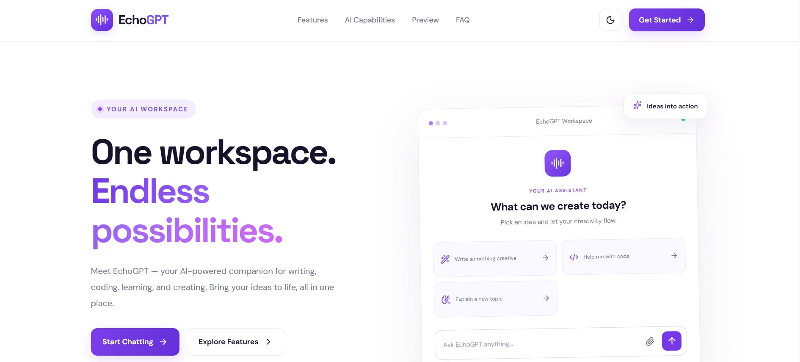
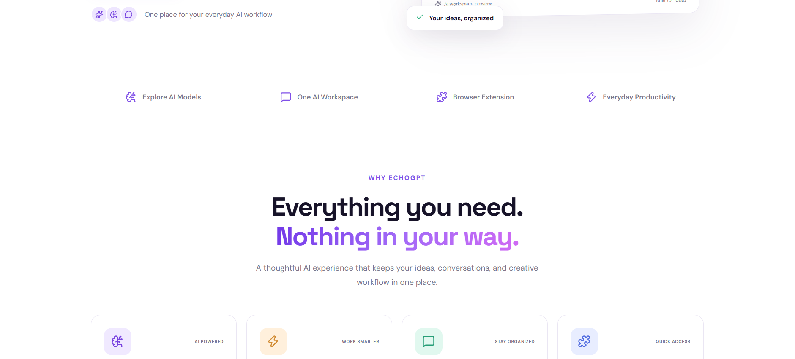
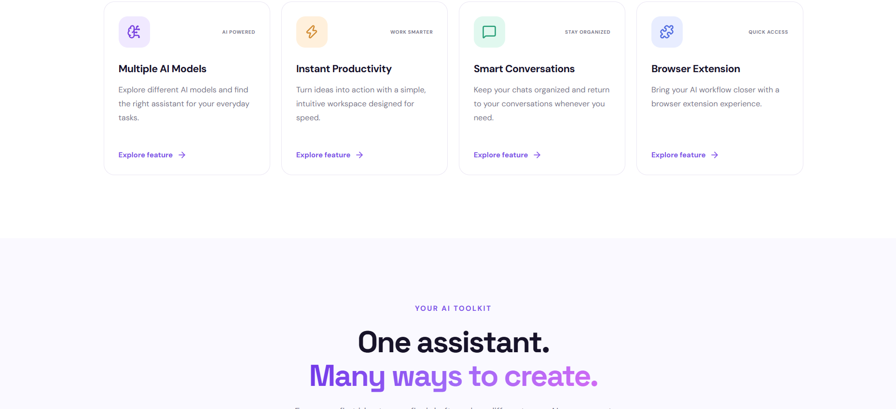
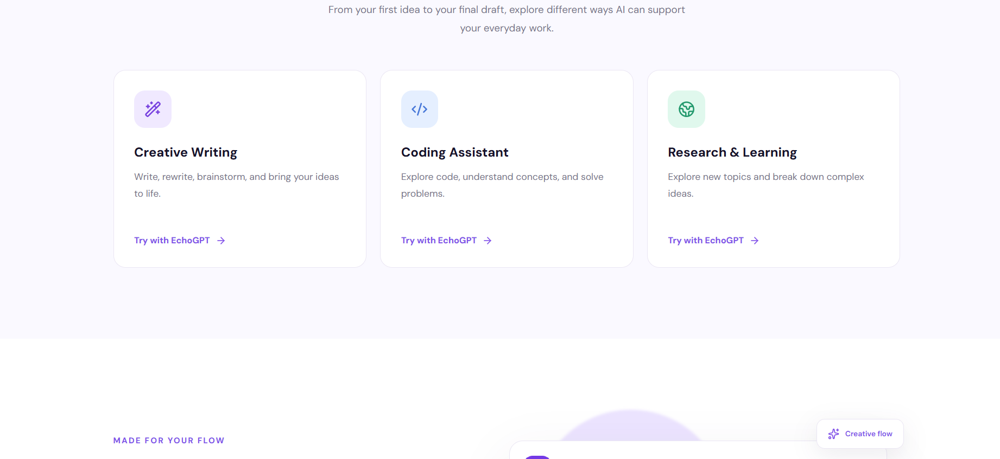
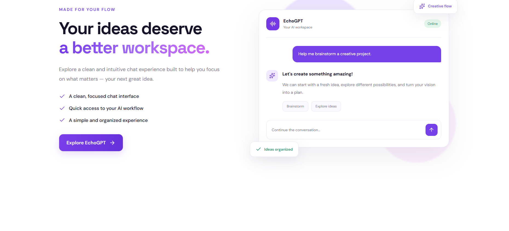
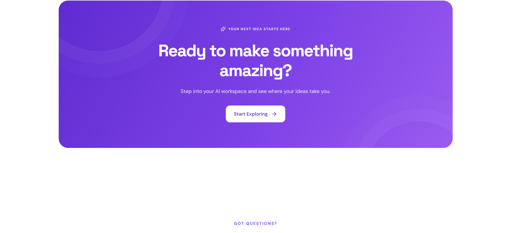
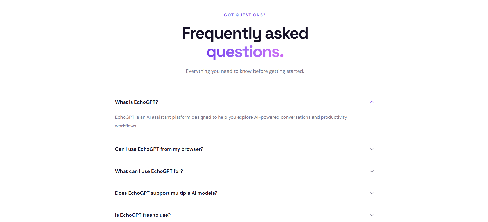
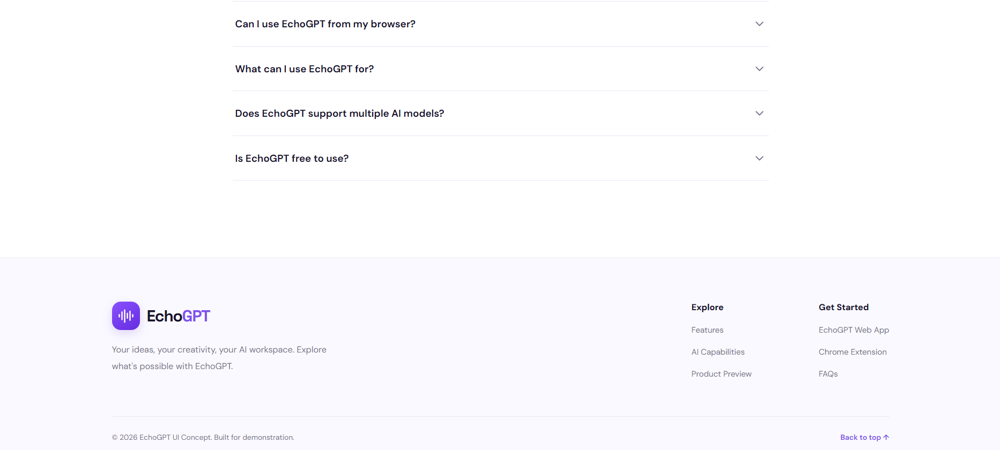

## 📸 Landing Page Screenshots

This section showcases the user interface of the **EchoGPT Landing Page**, a React-based AI chat interface inspired by modern AI chatbot applications.

The screenshots below provide a visual overview of the landing page's layout, design, and key interface components. Each section is designed to create a clean, user-friendly, and interactive experience.

### ✨ Key Features & UI Components

#### 1. 🧭 Navigation Bar
The navigation bar provides quick access to the main sections of the application. It includes branding and essential navigation options, helping users move around the interface easily.

#### 2. 💬 Main Chat Interface
The main chat area serves as the central workspace where users can interact with the AI assistant. It features a clean layout designed to make conversations simple and comfortable.

#### 3. 📂 Sidebar & Chat History
The sidebar provides access to previous conversations and other chat-related options. It helps users navigate their chat history and keeps the interface organized.

#### 4. ✍️ Message Input Area
The message input section allows users to type their prompts or questions. Its design focuses on accessibility and ease of use, making it convenient to interact with the chat interface.

#### 5. 🎨 UI Design & Theme
The interface uses a clean layout with a green-and-white color palette, consistent typography, and carefully styled buttons and icons to create a modern appearance.

#### 6. 🔘 Buttons & Interactive Elements
The landing page includes buttons and interface controls such as Sign In and sidebar options. These elements are styled to maintain visual consistency and provide a smooth user experience.

---

### 🖼️ Screenshots

The following screenshots demonstrate the overall landing page design and its different UI components.

